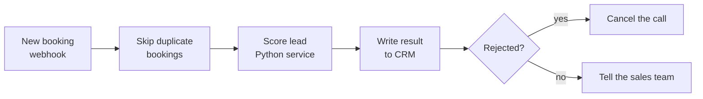

# Lead qualification pipeline: score every booking before the sales call

A small, working demo of a pattern I've run in production: every new booked call is checked automatically, scored against clear rules, written to the CRM with the reasons, and unqualified calls are cancelled before anyone wastes time on them.

This repo is a **clean, generic rebuild for demonstration**. It contains no client data, no client code and no credentials. All leads in `sample-data/` are fake.

> The production version of this pattern, built for a US business funding company, screened about 910 bookings in 10 weeks and shipped 17 fixes for real-world edge cases (duplicate webhooks, silent failures, bad data). The lessons from those fixes are built into this demo.

## How it works



1. **New booking:** a booking tool (Calendly, Cal.com, a form) sends a webhook to n8n.
2. **Skip duplicate bookings:** booking tools sometimes send the same event twice. n8n remembers every `booking_id` it has processed and drops repeats, so nobody is scored, charged or cancelled twice.
3. **Score lead:** n8n calls the scoring service, which returns a decision and the reasons behind it.
4. **Write result to CRM:** the decision, reasons and any missing fields are saved on the lead record.
5. **Cancel or notify:** rejected leads have their call cancelled. Everyone else goes to the sales team with the reasons attached.

Every outgoing call retries up to 3 times, because a CRM or calendar API being briefly down should not lose a lead.

## The decisions

| Decision | Meaning |
|---|---|
| `approve` | Meets every rule. Keep the call. |
| `fix` | Close, but the credit score needs work first. Keep the lead warm. |
| `reject` | Fails at least one hard rule. The call is cancelled and the reason recorded. |
| `needs_info` | Something required is missing. **Never guessed**: the missing fields are listed so the team can ask. |

The thresholds live in [`scoring_service/rules.json`](scoring_service/rules.json), so changing a rule is a one-line edit and needs no code change:

```json
{
  "min_credit_score": 650,
  "fixable_credit_score": 580,
  "min_months_in_business": 6,
  "min_monthly_revenue": 10000,
  "max_amount_to_monthly_revenue": 3.0
}
```

Example response:

```json
{
  "booking_id": "demo-006",
  "decision": "reject",
  "reasons": ["Requested amount is 5.0x monthly revenue, maximum is 3.0x."],
  "unknown": []
}
```

## Run it

Scoring service and tests:

```bash
pip install -r requirements.txt
pytest
uvicorn scoring_service.main:app --reload
```

Score a lead:

```bash
curl -X POST http://localhost:8000/score -H "Content-Type: application/json" -d "{\"booking_id\":\"t1\",\"credit_score\":700,\"months_in_business\":24,\"monthly_revenue\":40000,\"requested_amount\":50000}"
```

Full stack with n8n:

```bash
cp .env.example .env   # fill in your own test URLs
docker compose up
```

Then import [`n8n/lead-qualification.workflow.json`](n8n/lead-qualification.workflow.json) into n8n at http://localhost:5678 and POST a lead from `sample-data/leads.json` to the webhook.

## What's in the repo

```
scoring_service/   rules (pure functions), rules.json, FastAPI wrapper
tests/             unit tests, including every sample lead
sample-data/       7 fake leads with their expected decision
n8n/               the workflow, ready to import
docker-compose.yml n8n + scoring service
```

## Adapting it

The same pattern works for most "is this lead worth a call?" problems: swap the rules, point the CRM step at HubSpot, Close, Pipedrive, GoHighLevel or Airtable, and replace the cancel step with whatever your booking tool offers. An LLM step (Claude or OpenAI) can sit next to the rules to read free-text answers, with the rules still making the final call so every decision stays explainable.

---

Built by Mohamed Douzi, AI automation developer (n8n, Python, CRM and calendar integrations).
